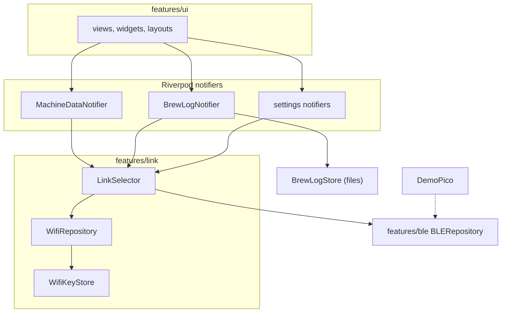

# Architecture

This document describes the structure of `expresso_control`, a Flutter app that monitors and controls a Rancilio Silvia espresso machine. The machine is driven by a Raspberry Pi Pico 2 W running the EspressoPico firmware ([expresso](https://github.com/Rolppe/expresso)). It names files and types instead of linking them; use a code search to jump to them.

## Bird's-eye view

The firmware owns the control loops (boiler temperature, pump, pre-infusion, scale). The app is a remote panel and logbook:

- It receives a stream of JSON objects from the Pico: live telemetry, settings packets, calibration state and, after each shot, a multi-part shot log.
- It sends short text commands (`tare`, `sync`, `stby:brew:<min>`, `cal:next`, `brew_log:ack:<id>` and so on).
- It keeps what the Pico does not: the shot archive with actual cup weight and rating, and the app's own settings.

The same JSON objects and commands travel over two transports, BLE and UDP over home Wi-Fi. The wire format is specified in the firmware repository: [docs/PROTOCOL.md](https://github.com/Rolppe/expresso/blob/main/docs/PROTOCOL.md). App-side summary: BLE exposes one notify characteristic (`2A29`, data) and one write characteristic (`2A2A`, commands) under service `180A`. UDP port 47211 carries `EXA1 hello` and `EXA1 <boot> <seq> <mac16> <command>`, where `mac16` is the first 16 hex characters of HMAC-SHA256 over `"<boot> <seq> <command>"`.

## Codemap

`lib/main.dart`: starts the `ProviderScope`, kicks every long-lived provider after the first frame, and forwards app lifecycle events (resume, pause) to the link.

`lib/core/`: `providers.dart` is the composition root: it creates the singleton `BLERepository`, the `WifiRepository`, the `WifiKeyStore` and the `LinkSelector`, and exposes the selector as `machineLinkProvider`. `standby_timeout.dart` and `keep_screen_on.dart` hold persisted settings (SharedPreferences); the standby ones are also sent to the Pico when a link comes up. `debug_log.dart` is the tagged logger `DLog`.

`lib/features/link/`: the transport abstraction. `machine_link.dart` defines `MachineLink` (data stream, connection stream, `sendCommand`, resume/pause hooks) and `WifiLink` (adds key, boot id and last packet time). `link_selector.dart` implements `MachineLink` over a BLE and a Wi-Fi link. `wifi_repository.dart` is the UDP client. `wifi_key_store.dart` persists key, host and port in the iOS Keychain.

`lib/features/ble/`: `ble_repository.dart` is the GATT client (scan, connect, notify framing, commands, watchdog). `ble_scan_policy.dart` is the pure scan/connect timing policy. `demo_pico.dart` is the simulated Pico used in the simulator. `ble_notifier.dart` exposes the connected flag to the UI.

`lib/features/data/`: `machine_data_notifier.dart` turns incoming JSON into one immutable `MachineStatus` (freezed) plus the chart series, runs the brew timer, drip-tray and startup auto-tare logic. `live_stale_policy.dart` decides when a silent link must drop a frozen BREW state.

`lib/features/brew_log/`: `brew_log_assembler.dart` (pure multi-part reassembly), `brew_log_store.dart` (the permanent `brew_shots.jsonl` and the single `pending_brew_log.json`), `brew_log_notifier.dart` (assemble, persist, ack, open the weight sheet, notification).

`lib/features/ui/`: views (home, settings, scale and pressure calibration wizards, shot list and detail), widgets (controls, chart, value display, standby overlay) and portrait/landscape layouts. Views read notifiers and call `sendCommand`; they hold no transport logic.

`lib/features/usb/`: Android-only USB-serial development tools, reachable from Settings only when `Platform.isAndroid`. Inactive on iOS.

`lib/models/`: `MachineStatus`, `DataPoint` (freezed and json_serializable, generated files committed) and `BrewLog` with its sample encodings.

`ios/Runner/`: Info.plist (Bluetooth, local-network usage strings, `bluetooth-central` background mode) and `AppDelegate.swift`, which implements the `espressopico/ble_keepalive` method channel. On iOS its start/stop calls are no-ops and `showBrewWeightPrompt` posts a local notification.

`test/`, `uitest/`, `mac/`: Dart unit tests; an XCUITest step-file driver for the simulator; the launchd installer for the phone (see `docs/DEVELOPMENT.md`).

## Invariants

- The UI and all notifiers use `MachineLink` only. Nothing above `LinkSelector` calls `BLERepository` or `WifiRepository`. The only references outside the link layer are the composition root (`providers.dart`) and the static `BLERepository.demoMode` flag, read in `standby_timeout.dart`.
- BLE is never stopped by the selector. `LinkSelector.disconnect()` stops only Wi-Fi.
- Exactly one link's data reaches the app at a time. The inactive link's JSON is dropped in `_onBleData` / `_onWifiData`. The one exception is `wifi_key`, which is consumed from BLE regardless of the active link.
- The Wi-Fi key never travels over Wi-Fi and never reaches a log, a string or an error message. `WifiLinkConfig.toString` masks it, and `WifiRepository` drops any `wifi_key` object it receives.
- `wifi:` commands always go over BLE, even when Wi-Fi is active.
- A link switch is never made within 2 s of a shot-log frame from the active link.
- The Wi-Fi client has at most one command in flight. The next one is sent only after an ack, a failure or a timeout.
- A shot log is written to disk as pending before it is acknowledged to the Pico, and removed only after the user has saved or dismissed it.
- The app has no direct write path to machine hardware; all control is a text command that the firmware validates.
- Network and platform code is guarded: Android-only behaviour is behind `Platform.isAndroid`, and the demo Pico is compiled in only with `EXPRESSO_DEMO=true`.

## Boundaries

- **Phone to Pico:** the only boundary with an external process. Everything crossing it is JSON in, text commands out, over BLE or UDP. On UDP the Pico accepts only commands with a valid MAC; on BLE the app connects to the device advertising the name `EspressoPico`.
- **Dart to iOS native:** one method channel (`espressopico/ble_keepalive`) for the post-shot notification. Plugins (flutter_blue_plus, flutter_secure_storage, wakelock_plus) cover the rest.
- **Pure core versus plugin shell:** `BleScanPolicy`, `LiveStalePolicy`, `BrewLogAssembler`, `wifiMac16`, the standby choices and `SafeBouncingScrollPhysics` have no plugin dependency and are tested on the host. `BLERepository` and the UI are not.

## Cross-cutting concerns

**Error handling.** Transport errors never throw into the UI. `WifiRepository` completes a command's future when it fails; the link reports `isConnected = false` after 3 s of silence. The BLE side logs and reschedules. Malformed frames are dropped, and a shot log missing its meta part triggers a resend request to the Pico.

**Reconnection and liveness.** BLE: a 12 s watchdog, backoff of 2 s per consecutive failure up to 20 s, a forced disconnect before each connect to clear OS-level zombie connections. Data: if live packets stop while BREW or SOFT_RELEASE is shown, `LiveStalePolicy` returns the UI to IDLE after 12 s or 4 s respectively. A fresh Pico boot id restarts the Wi-Fi start series (`sub`, `sync`, `sync`, `brew_log?`).

**Testing.** Host unit tests use a fake `MachineLink` and, for Wi-Fi, a fake Pico on a loopback UDP socket with injectable timings and clock. Behaviour that needs a radio was checked on the phone, with a console log and screenshots, and in the simulator through the XCUITest driver. See `docs/DEVELOPMENT.md`.

**Observability.** `DLog` prints tagged lines (BLE, UI, SET, DATA, SYS). It is enabled in release builds too, which is useful for field debugging with `devicectl` console output but should be a switch before a public release.

**Security.** Wi-Fi commands are authenticated with a pre-shared 32-byte key in the Keychain and a boot id plus a rising sequence number, which blocks replays across Pico restarts. The app does not encrypt traffic; the HMAC authenticates commands only. `NSLocalNetworkUsageDescription` and Bluetooth strings are declared in Info.plist.

**Performance.** Chart series are pruned on every update (`_pruneGraphSeries`), the BLE receive buffer is capped at 64 KB, and the Wi-Fi socket is closed when the app is backgrounded.

## Key design decisions

### 1. One interface over BLE and Wi-Fi, BLE always on

- Context: Wi-Fi gives lower latency at home, but iOS suspends UDP sockets when the app is backgrounded, while CoreBluetooth with the `bluetooth-central` background mode keeps running. The shot-finished prompt must still arrive with the phone locked.
- Decision: lift the surface the UI already used on the BLE class into `MachineLink`, and let `LinkSelector` own both transports. `auto` prefers Wi-Fi once connected, with a 3 s hysteresis and a quiet period around shot logs; background forces BLE. BLE scanning and connection are never paused.
- Consequences: the UI changed very little. The cost is two live links and a switch protocol (`sync` and `brew_log?` on every switch) that needed its own tests.

### 2. Wi-Fi key handover only over BLE

- Context: the UDP link needs a shared secret on the phone. Typing a 64-character key is error-prone, and sending it over an unauthenticated network would defeat the point.
- Decision: the app asks for it with `wifi:key?` once BLE is connected and no key is stored (3 tries), stores it in the Keychain, and ignores `wifi_key` on any other path. A hidden Settings field allows pasting a key for simulator use.
- Consequences: the secret is only ever sent over the BLE link. A phone that has never been paired over BLE cannot use Wi-Fi.

### 3. Serialised commands with sequence numbers on UDP

- Context: the Pico drops any `seq` lower than the last one it saw. A lost command retried after a newer one would be refused.
- Decision: the client queues commands, sends one at a time, retries the same `seq` up to 3 times at 300 ms, and treats a `stale` answer as a reason to say hello again and retry with the new boot id.
- Consequences: throughput is limited to one command per round trip, which is enough for a control panel, and ordering is guaranteed.

### 4. Pure policies extracted for host testing

- Context: BLE reconnect storms and "frozen BREW" screens are problems recorded in code comments (OS rate limits on scanning, "connected" zombie links, a second app holding the Pico's connection), and could only be reproduced with the machine.
- Decision: move the decision logic (`BleScanPolicy`, `LiveStalePolicy`, `BrewLogAssembler`) into classes with no plugin dependency and an injectable clock.
- Consequences: the rules are covered by fast tests; the glue in `BLERepository` stays untested by design.

### 5. Demo Pico as a compile-time flag

- Context: the iOS simulator has no CoreBluetooth, and an agent working without the machine needs data to look at.
- Decision: `DemoPico` emits the same JSON maps as the firmware, selected with `--dart-define=EXPRESSO_DEMO=true`. It was made a build flag rather than a setting so that device builds cannot start it. Features that the firmware cannot do are not invented (at the time of writing, only the pressure calibration was simulated).
- Consequences: end-to-end UI runs and screenshots without hardware, and the XCUITest driver can run shot flows. The simulator cannot validate notifications on a locked phone.

### 6. Free Apple ID signing with automated renewal

- Context: the author chose the free provisioning profile over a paid developer account; it expires after 7 days.
- Decision: a launchd agent on the build Mac, `mac/expresso-asennus.sh`, runs every 30 minutes and rebuilds and reinstalls only when fewer than 48 h of profile are left, the Mac screen is unlocked and the phone is reachable; otherwise it posts a notification when below 36 h.
- Consequences: no manual re-signing in the normal case, but the process depends on the author's Mac layout and is documented, not portable.
