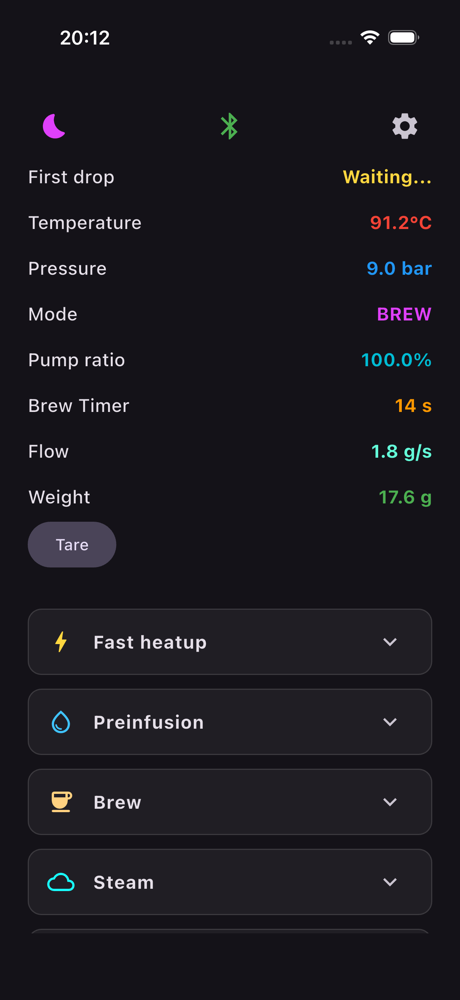
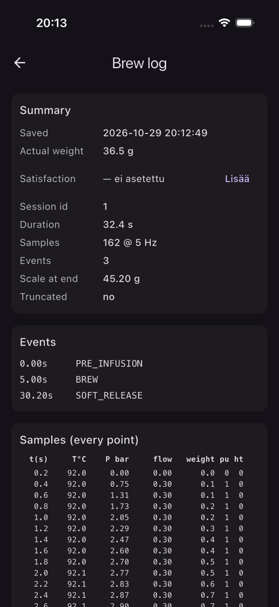
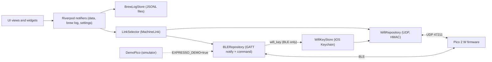

# expresso_control

[](https://github.com/Rolppe/expresso_control/actions/workflows/ci.yml)

A Flutter app (built and run on an iPhone) that monitors and controls a Rancilio Silvia espresso machine through a Raspberry Pi Pico 2 W running the EspressoPico firmware.

The phone talks to the Pico over Bluetooth LE and, when it is on the home network, over authenticated UDP on Wi-Fi. The app picks the better link by itself and keeps a shot log on the phone. The Dart package is named `silvia_pico_ui`; the repository is `expresso_control`.

## What it does

- Shows live boiler temperature, pressure, brew mode, pump ratio, brew timer, flow and scale weight, with a temperature and pressure chart.
- Controls the machine from the phone: tare, fast heat-up, pressure equalization, pre-infusion trigger, standby (wake, standby delay after start and after a shot, standby temperature).
- Runs a scale calibration wizard (quick correction or full two-corner program) and a pressure calibration wizard against a reference gauge.
- Records every shot: the Pico sends a shot log after the brew, the app asks for the actual cup weight and a 1-4 satisfaction rating, and stores it in a local JSONL file (`brew_shots.jsonl`). The list can be browsed, edited and deleted.
- Connects over BLE or Wi-Fi (UDP). The "Yhteys" setting chooses `auto`, `wifi` or `ble`.
- Keeps the BLE link alive with the screen locked (iOS `bluetooth-central` background mode) and raises a local notification when a shot has finished so the weight can be entered.
- Has a demo mode with a simulated Pico, so the whole UI runs in the iOS simulator without hardware.

## Visual

 

*Left: the live dashboard 14 s into the demo shot. Right: the stored brew log of that shot (summary, phase events, per-sample table). Both are screenshots from the iOS simulator running the `--dart-define=EXPRESSO_DEMO=true` build, where `lib/features/ble/demo_pico.dart` simulates the machine, so the values are simulated, not measured. Driven with the step driver in [uitest/](uitest/) (the dashboard was captured a few seconds after the first demo shot started; the brew log is the one the app saved for it, with the actual weight entered by hand as 36.5 g).*

## Architecture at a glance



See [ARCHITECTURE.md](ARCHITECTURE.md) for the codemap, invariants and design decisions.

## Engineering highlights

- **One interface over two transports.** The UI never knows whether BLE or Wi-Fi is active. `MachineLink` ([machine_link.dart](lib/features/link/machine_link.dart)) is the shared surface; `LinkSelector` ([link_selector.dart](lib/features/link/link_selector.dart)) owns both links, switches with a 3 s hysteresis, never switches within 2 s of a shot-log frame, and forces BLE while the app is in the background because iOS suspends UDP sockets.
- **Authenticated UDP command channel.** [wifi_repository.dart](lib/features/link/wifi_repository.dart) speaks the `EXA1` datagram protocol: a hello that returns the Pico's boot id, then `EXA1 <boot> <seq> <mac16> <command>` with a truncated HMAC-SHA256. Commands run one at a time with a 300 ms ack timeout and 3 retries, because the Pico drops any sequence number lower than the last one seen. Wire protocol: [expresso docs/PROTOCOL.md](https://github.com/Rolppe/expresso/blob/main/docs/PROTOCOL.md).
- **Key handover over BLE only.** The shared Wi-Fi key is requested with `wifi:key?` over the paired BLE link and stored in the iOS Keychain ([wifi_key_store.dart](lib/features/link/wifi_key_store.dart)). A `wifi_key` object arriving over Wi-Fi is dropped, and the key is never logged.
- **BLE JSON framing.** Notifies arrive in MTU-sized chunks. `_onNotifyBytes` in [ble_repository.dart](lib/features/ble/ble_repository.dart) reassembles objects by brace balance, aware of string literals and escape characters, with a 64 KB cap that resets lost framing.
- **Resilient BLE connection.** A 12 s watchdog tears down "zombie" links that the OS reports as connected, failed connects back off (2 s per consecutive failure, capped at 20 s), connect and scan are single-flight, and scan timing is a pure, unit-tested class ([ble_scan_policy.dart](lib/features/ble/ble_scan_policy.dart)).
- **Shot log that survives restarts.** The Pico sends a multi-part log (meta, samples, end). `BrewLogAssembler` ([brew_log_assembler.dart](lib/features/brew_log/brew_log_assembler.dart)) reassembles it, the log is saved as pending on disk before `brew_log:ack:<id>` is sent, and the weight/rating sheet is restored after an app restart ([brew_log_store.dart](lib/features/brew_log/brew_log_store.dart)).
- **Simulated Pico.** `--dart-define=EXPRESSO_DEMO=true` swaps the GATT link for [demo_pico.dart](lib/features/ble/demo_pico.dart), which emits the same JSON as the firmware, including a full shot cycle, a shot-log multipack and the pressure calibration dialogue.
- **Driving the app without hands.** [uitest/](uitest/) holds an XCUITest "Ohjain" (controller) that executes step files (`tap:`, `waitfor:`, `shot:`, `dump:` ...) in the simulator, so an agent can walk the UI and capture screenshots. [mac/](mac/) holds a launchd agent that rebuilds and reinstalls the app on the phone before the free 7-day provisioning profile expires.

## Tech stack

| Layer | Technology | Version |
|---|---|---|
| Framework | Flutter / Dart | Flutter 3.41.6, Dart 3.11.4 (lockfile requires Flutter >= 3.41, Dart >= 3.11) |
| State | flutter_riverpod | 2.6.1 |
| Bluetooth | flutter_blue_plus | 1.36.8 |
| Charts | fl_chart | 0.70.2 |
| Models | freezed, json_serializable (generated files committed) | 2.5.8, 6.9.5 |
| Storage | flutter_secure_storage (Keychain), shared_preferences, path_provider | 11.2.0, 2.5.6, 2.1.6 |
| Crypto | crypto (HMAC-SHA256) | 3.0.7 |
| Target | iOS | 15.0 minimum |
| UI test driver | XCUITest via xcodegen | `uitest/project.yml` |

## Architecture in short

`lib/` is organised by feature: `features/link` (transport-agnostic interface, selector, Wi-Fi), `features/ble` (BLE and the demo Pico), `features/brew_log`, `features/data` (live telemetry notifier), `features/ui` (views, widgets, layouts), `models` and `core`. Riverpod providers in [lib/core/providers.dart](lib/core/providers.dart) wire a singleton `BLERepository`, a `WifiRepository` and the `LinkSelector`; everything above the selector talks to the `MachineLink` interface only. Details and design decisions are in [ARCHITECTURE.md](ARCHITECTURE.md).

## Repository layout

```
lib/                 app source (Dart), ~8 800 lines excluding generated files
  core/              providers, logging, wakelock, standby settings
  features/          link, ble, brew_log, data, ui, usb (Android-only dev tooling)
  models/            MachineStatus, BrewLog, DataPoint (freezed + json_serializable)
ios/                 Runner project, Info.plist, AppDelegate (notification channel)
test/                9 test files, 2 100 lines
uitest/              XCUITest step-file driver and step files (simulator)
mac/                 install script and launchd plist for the free 7-day signing
paketit/             agent briefs, specs, corrections, delegation log (Finnish)
REKISTERI.md, HISTORIA.md, ARKISTO.md   working notes (Finnish), see docs/DEVELOPMENT.md
app-lahde-20261028.patch                newer UI source changes, not installed (see docs/DEVELOPMENT.md)
```

## Getting started

Prerequisites: Flutter 3.41.x (Dart 3.11.x). For device builds also Xcode and an Apple ID; the repo was built with Xcode 27 and CocoaPods.

```
flutter pub get          # generated freezed/json files are already committed
flutter test             # unit tests, no hardware needed
```

Run without hardware (iOS simulator, simulated Pico):

```
flutter run -d <simulator-id> --dart-define=EXPRESSO_DEMO=true
```

Run against a real machine: this needs the EspressoPico firmware on a Pico 2 W ([expresso](https://github.com/Rolppe/expresso)) and a physical iPhone, since the iOS simulator has no CoreBluetooth. Set your own team in `ios/Runner.xcodeproj/project.pbxproj` (`DEVELOPMENT_TEAM = YOUR_TEAM_ID;`), then `flutter run --release -d <iphone-id>`. With the free Apple ID the provisioning profile expires after 7 days; [mac/expresso-asennus.sh](mac/expresso-asennus.sh) automates the reinstall but expects the author's Mac layout (see Limitations). The Wi-Fi link additionally needs the key, which the Pico hands over once via BLE.

If you regenerate the freezed code: `dart run build_runner build --delete-conflicting-outputs`. This is the standard build_runner invocation for the dev dependencies in `pubspec.yaml`; it was not run while writing these docs.

## Tests

`flutter test` runs 9 files with 92 `test(...)` declarations (counted with grep); They cover the pure and protocol-level parts:

- `wifi_repository_test.dart`: HMAC test vector, hello, ack retry, stale boot, filtering, against a local fake Pico on a loopback UDP socket.
- `link_selector_test.dart`: auto switching, hysteresis, no switch during a shot log, BLE never stopped, key handover.
- `brew_log_test.dart`: multipack assembly and rejection cases.
- `ble_scan_policy_test.dart`, `live_stale_policy_test.dart`, `standby_timeout_test.dart`, `machine_status_test.dart`, `safe_bouncing_scroll_physics_test.dart`.
- `widget_test.dart` is a placeholder (`1 + 1 == 2`), not a widget test.

Not covered: the real BLE stack, UI widgets, the iOS notification path and the launchd installer. Those were checked by hand or with the XCUITest driver in `uitest/` on a Mac with a simulator or the phone.

Test run status: CI (GitHub Actions, Ubuntu, Flutter 3.41.6) runs `flutter test` on every push; the first run on 29 October 2026 passed all 92 tests. On the author's Mac, `flutter test` stalls before any output (the test runner process idles), so the runs are on CI.

## How it was built

Mikko Paaso set the requirements, designed the architecture and directed the work; Claude Code AI agents wrote the code from written briefs. Each brief (in [paketit/](paketit/)) lists the files an agent may touch, the steps, an acceptance script and a stop condition; the agent's result counted only when the acceptance commands, tests and simulator or device runs passed. When one failed, the planner wrote a correction file rather than patching by hand, and the briefs show three of these. Mikko reviewed the results and decided what to keep. The Android app this was ported from, the BLE link and the firmware protocol came earlier; the iOS port, the Wi-Fi link, the demo mode, the UI driver and the install automation are documented in the registers. The repository was squashed to 2 commits (2026-10-28 and 2026-10-29); the second one carries a `Co-Authored-By` trailer, and the day-by-day history is in [HISTORIA.md](HISTORIA.md). More in [docs/DEVELOPMENT.md](docs/DEVELOPMENT.md).

## Status and limitations

- iOS only as published: `android/` is not in the repo, although the Dart code still has Android branches (foreground-service channel, USB dev tools).
- Extracted from a private monorepo. [mac/expresso-asennus.sh](mac/expresso-asennus.sh), [uitest/ajo.sh](uitest/ajo.sh) and the briefs in `paketit/` refer to the author's Mac paths and a source project that is not in this repo.
- `DLog` logging is enabled in release builds (`DLog.enabled = true` in `lib/core/debug_log.dart`).
- The package name `silvia_pico_ui` and the user-visible strings are partly Finnish and partly English.
- The internal notes are in Finnish. Their first entries date from 5 Oct 2026; this README was written against the state of 29 Oct 2026.
- `app-lahde-20261028.patch` holds newer UI changes that were never installed on the phone and are not applied to `lib/`.
- Real BLE and Wi-Fi behaviour needs the Pico and a phone; nothing in CI exercises it.

## Related repositories

- [expresso](https://github.com/Rolppe/expresso): the Pico 2 W firmware this app talks to.

## License

AGPL-3.0-only, see [LICENSE](LICENSE). Copyright (c) 2026 Mikko Paaso.
